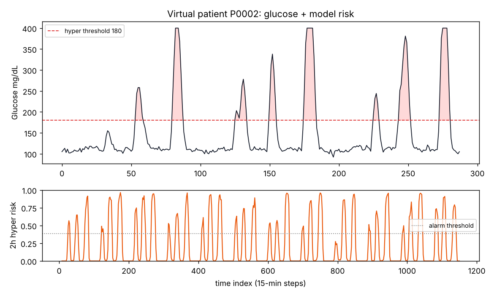
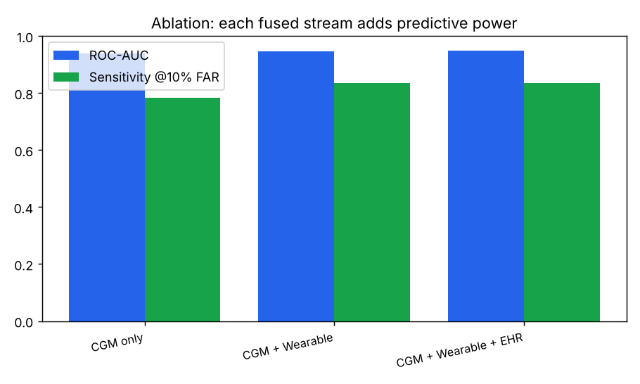
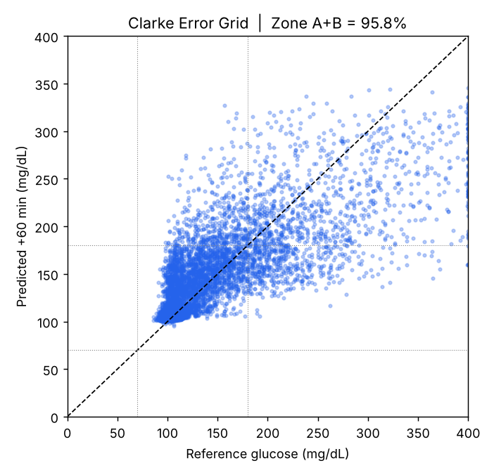

<!--
  SUBMISSION FOLDER NAME (per guidelines): <Team Name>_<College Name>
  This team: Healthcure_IITKanpur   -- name your top-level repo/folder accordingly.
-->

# GlucoTwin — A Predictive Digital Twin for Type 2 Diabetes

> Fusing static Electronic Health Records with live wearable + CGM data to
> predict a hyperglycemic excursion **~60 minutes before it happens**, and to
> let a clinician run *what-if* simulations on a virtual patient.
>
> Built for the **Happiest Health — Reimagining and Reforming Healthcare in
> India Summit 2026** Digital Twin Challenge.

▶️ **Demo video:** https://youtu.be/roJqn0QEc-Y



---

## 1. Team details

| | |
|---|---|
| **Team name** | **Healthcure** |
| **College / Incubator** | **IIT Kanpur** |
| **Team leader** | **Himanshu** — IIT Kanpur |
| **Team size** | 1 (individual participant) |
| **Contact** | [himanshugh23@iitk.ac.in](mailto:himanshugh23@iitk.ac.in) |

## 2. Project title

**GlucoTwin — A Predictive Digital Twin for Type 2 Diabetes Management.**

## 3. Problem statement

India is the **diabetes capital of the world**, with one of the largest Type 2
Diabetes (T2D) populations globally and a severe shortage of endocrinologists
relative to patients. Care today is **reactive**: a patient learns their
glucose was dangerously high *after* it happened, at a clinic visit weeks later.

**GlucoTwin makes it proactive.** It builds a dynamic *virtual replica* of a
T2D patient by fusing two data streams and predicts an **adverse glycemic
event — a hyperglycemic excursion (glucose > 180 mg/dL) — 60 to 120 minutes in
advance**, giving the patient and clinician a window to act (a walk, a meal
adjustment, a medication reminder).

## 4. Healthcare use case

**Who it's for:** clinicians and care teams managing people with Type 2 Diabetes
remotely — and, through them, patients like *Meera*, a 58-year-old in Coimbatore
whose smartwatch and hospital records never talk to each other.

**How it's used:** a doctor opens the GlucoTwin dashboard and sees each virtual
patient's live glucose curve with a **shaded predicted-risk window**, a **risk
gauge and alert**, an **explanation** of *why* the patient is at risk right now,
and a **what-if panel** to test interventions — e.g. *a 20-minute walk takes this
patient's risk from 68% down to 37%*. This supports **remote monitoring and
triage** (one clinician, hundreds of patients ranked by risk), **personalised
lifestyle coaching**, and **earlier action** that slows complications such as
kidney, eye and heart disease.

## 5. The two fused data streams (challenge core requirement)

| Stream | Type | Fields | Source in this PoC |
|---|---|---|---|
| **EHR** | Static / historical | demographics, BMI, HbA1c, fasting glucose, diabetes duration, medications (metformin/insulin/sulfonylurea), comorbidities (HTN, CKD, retinopathy), family history (genetic-risk proxy) | Synthetic engine (Synthea-style) · real-data loader for **MIMIC-IV / Synthea** |
| **Wearable + CGM** | Dynamic / real-time | continuous glucose (CGM), heart rate, **HRV**, steps, sleep stage, meal events — every 15 min | Synthetic engine · real-data loader for **ShanghaiT2DM**, **PPG-DaLiA**, **MMASH** |

**How the fusion works (and why it's real):** at each timestep we build one
feature vector = *[summary of the last 2 h of the dynamic streams] ‖ [the static
EHR vector]* (late concatenation). The synthetic physiology is deliberately
designed so **neither stream alone is sufficient**: whether an upcoming meal
spikes past 180 mg/dL is governed by a hidden insulin-resistance state that is
*anchored by the EHR* (chronic instability, CKD) and *fluctuates with factors
only the wearable reveals* (acute stress via HRV, sleep debt, recent activity).
Our **ablation study proves each stream adds predictive value** (§8).

## 6. Technical stack

- **Language / runtime:** Python 3.10+
- **Core ML:** scikit-learn (`HistGradientBoostingClassifier`), auto-upgrades to
  **XGBoost** if installed. Optional **PyTorch LSTM** fusion arm
  (`src/models/sequence_model.py`) for the sequence-model variant.
- **Explainability:** SHAP (TreeExplainer) with a model-agnostic fallback.
- **Dashboard:** Streamlit + Plotly.
- **Data:** pandas / numpy; PyArrow for artifacts.

## 7. AI/ML model & framework details

**Model design — a hybrid digital twin:**

1. **Deployed predictor (backbone):** gradient-boosted trees on the fused
   feature vector → probability of a hyperglycemic event in the next 60–120 min.
   Chosen for interpretability, speed, and native SHAP support on a PoC-sized
   dataset. (We considered a Transformer and chose the simpler model
   deliberately — justified restraint over buzzword-stacking.)
2. **Glucose forecaster:** a regression head predicting glucose at +60 min, used
   for the **Clarke Error Grid** clinical-safety evaluation.
3. **Optional LSTM arm:** encodes the raw multivariate window; the static EHR
   vector is concatenated at the dense head (**late fusion**) — the same fusion
   point, shown to generalise to sequence models.
4. **Counterfactual engine** (`src/simulate/`): perturbs controllable levers
   (activity, carbs, medication, sleep) and re-scores risk → this is what makes
   it a **twin**, not just a classifier.

**Prediction target:** probability that glucose exceeds **180 mg/dL** in the next
**60–120 minutes**, from the last **2 hours** of fused data. **Evaluation:** patient-level
train/test split (no leakage), ROC-AUC, PR-AUC, sensitivity at a fixed 10% false-alarm
rate, warning lead time, Brier calibration, and the Clarke Error Grid.

## 8. Results (reproducible via `python run.py`)

**Ablation — each fused stream adds predictive power** (held-out patients, no leakage):

| Model | ROC-AUC | PR-AUC | Sensitivity @ 10% false-alarm |
|---|---|---|---|
| CGM only | 0.939 | 0.769 | 0.784 |
| CGM + Wearable | 0.947 | 0.805 | 0.835 |
| **CGM + Wearable + EHR (full)** | **0.950** | **0.820** | **0.837** |

**Deployed model (full fusion):** ROC-AUC **0.950** · PR-AUC **0.820** · Brier
**0.074** (well-calibrated) · **Sensitivity 0.84 at a 10% false-alarm rate** ·
**mean warning lead time ≈ 50 min**.

**Glucose forecast clinical safety (Clarke Error Grid):** **95.8% of predictions
in Zones A+B** (clinically acceptable) · RMSE **31.7 mg/dL** · MAE 16.8 mg/dL at
a 60-minute horizon.

<p align="center">


</p>

*(Numbers come from the default synthetic cohort, seed 42. They will shift
slightly with `--patients/--days/--seed` or real data, but the ablation ordering
and clinical ranges are stable.)*

## 9. Data constraints & ethics (sandbox rules)

**No real patient data is used.** Per the **DPDP Act (India)** and **HIPAA**,
GlucoTwin trains only on **synthetic / open / anonymized** data:

- **Built-in synthetic engine** (`src/data/synthetic.py`) — a physiologically
  grounded generator; the repo runs end-to-end with **zero downloads**.
- **Optional real open datasets** via `src/data/loaders.py`:
  [ShanghaiT1DM/T2DM](https://www.nature.com/articles/s41597-023-02737-4) (CGM),
  [Synthea](https://github.com/synthetichealth/synthea) /
  [MIMIC-IV](https://physionet.org/content/mimiciv/) (EHR),
  [PPG-DaLiA](https://archive.ics.uci.edu/dataset/495/ppg+dalia) &
  [MMASH](https://physionet.org/content/mmash/) (wearable).

## 10. Quickstart

```bash
git clone <this-repo-url> && cd Healthcure_IITKanpur
pip install -r requirements.txt

python run.py                      # full pipeline, synthetic, zero downloads (~1 min)
streamlit run dashboard/app.py     # launch the doctor dashboard

# options
python run.py --patients 200 --days 14 --seed 7
python run.py --shanghai data/shanghai   # swap in real CGM (needs openpyxl)
```

`run.py` writes everything the dashboard needs into `artifacts/`
(trained models, scored data, metrics `report.json`, and the plots above).

## 11. Repository structure

```
Healthcure_IITKanpur/
├── run.py                     # one-command end-to-end pipeline
├── requirements.txt
├── LICENSE                    # MIT (see §12)
├── config.yaml                # tunable parameters
├── src/
│   ├── data/synthetic.py      # two-stream synthetic engine (EHR + CGM/wearable)
│   ├── data/loaders.py        # real open-dataset loaders (optional)
│   ├── features/engineering.py# fused feature table (window ‖ EHR)
│   ├── models/train.py        # ablation + deployed models + evaluation
│   ├── models/sequence_model.py# optional LSTM late-fusion arm
│   ├── evaluate/metrics.py    # lead time, sens@FAR, calibration, Clarke grid
│   ├── explain/shap_explain.py# SHAP global + local explanations
│   └── simulate/counterfactual.py # what-if lever simulation (the "twin")
├── dashboard/app.py           # Streamlit doctor dashboard
├── docs/                      # architecture diagram (PDF) + presentation (PDF/PPTX)
├── artifacts/                 # generated models, metrics, plots
└── tests/test_pipeline.py     # smoke test
```

## 12. Open-source license

Released under the **MIT License** — see [`LICENSE`](LICENSE). All datasets
referenced are used under their own open licenses; no proprietary or identifiable
patient data is included.

## 13. Demo video

▶️ **Watch on YouTube (unlisted):** https://youtu.be/roJqn0QEc-Y

[](https://youtu.be/roJqn0QEc-Y)

A narrated walkthrough of the problem, the approach and a live demo of the working
dashboard (subtitled).

## 14. Submission checklist

| Required item | Where it is |
|---|---|
| Team details | §1 |
| College / Incubator information | §1 — IIT Kanpur |
| Project title | §2 |
| Problem statement | §3 |
| Healthcare use case | §4 |
| Technical stack | §6 |
| AI/ML model or framework details | §7 |
| Demo video (unlisted YouTube, link in README) | §13 — https://youtu.be/roJqn0QEc-Y |
| Open-source license details | §12 · [`LICENSE`](LICENSE) (MIT) |
| Architecture diagram (PDF/PPT) | [`docs/GlucoTwin_Architecture.pdf`](docs/GlucoTwin_Architecture.pdf) |
| Presentation (PDF/PPT) — project details & outcomes | [`docs/GlucoTwin_Deck.pdf`](docs/GlucoTwin_Deck.pdf) · [`docs/GlucoTwin_Deck.pptx`](docs/GlucoTwin_Deck.pptx) |
| All files and links publicly accessible | Public repository · video is *unlisted* (anyone with the link can view) · datasets link to public sources |
